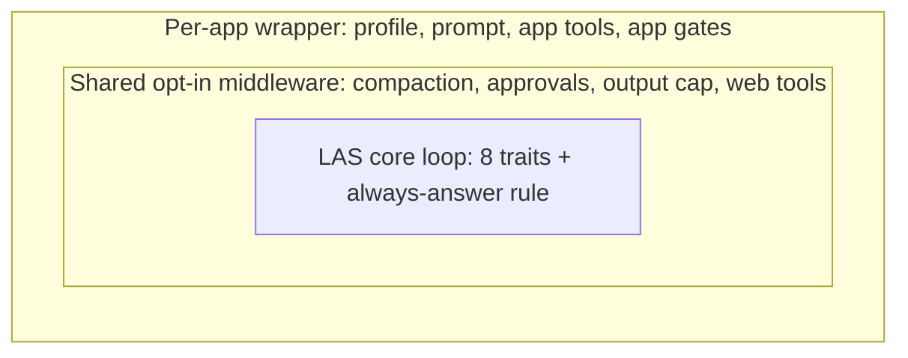
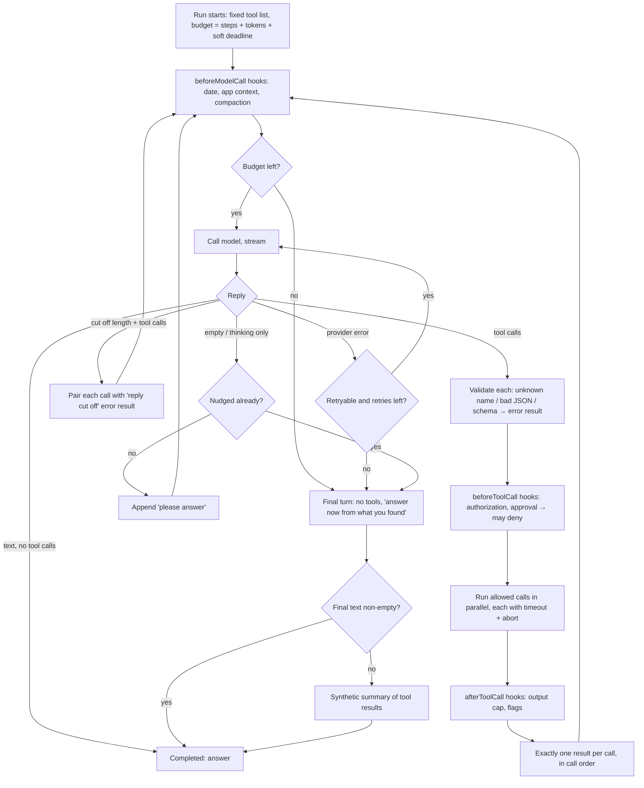

# 40 — Build the 8 core loop traits into lazy-agent-service (2026-10-17, rev 2)

Status: PLAN (not started). Verification standard: `.agents/plan-verification-standard.md`.
Labels: **VF** verified fact (dated 2026-10-17), **TC** testable claim (test named), **A-n** assumption (risk + validation).

## 1. What this plan is

- **lazy-agent-service (LAS) is the agent harness.** It adds no outside agent framework as a dependency: no pi, omp, Hermes, dsh, Vercel AI SDK or LangChain.
- **Hermes Agent, oh-my-pi/pi and prism-service are reference code only.** For each trait we read how they do it (file:line below), then write the same behavior in LAS's own TypeScript, with LAS tests.
  - Hermes, pi and omp are MIT: short adapted snippets are allowed with a source comment.
  - prism-service is Rod's: read only, never edited.
  - Read-only clones live in `.scratch/harness-research/{hermes-agent,pi,deepseek-harness}`; omp is installed under `~/.nvm/.../@oh-my-pi/pi-agent-core`.
- **Shape ("onion"):**

- **Non-goals:**
  - editing Rod's repos;
  - trading control endpoints or `v3_system_commands`;
  - swapping models;
  - replacing scraper-service.

## 2. Why: the measured problem (VF)

Same GLM model, same LAS search backend, 8 basic questions:
- A bare ~60-line loop passed 8/8.
- LAS `/v1/runs` passed 3/8 on trading-strategy-chat-v1 and 4/8 on html-notes-canvas-v1.

Every failure is in LAS layers above the loop:

| # | Failure | Where (LAS) |
|---|---|---|
| F1 | Token budget counts JSON bytes as tokens, then kills the run with evidence in hand | `src/services/CanonicalProviderBudget.ts:34-36` |
| F2 | The deadline aborts the run instead of answering with what it has | `src/services/RunExecutionEngine.ts:269` (abort), `:777-791` (fail) |
| F3 | Local tools are advertised to the model with no client to run them, so the run hangs until the deadline | `RunExecutionEngine.ts:520-536`; `src/services/LocalToolContinuation.ts:9-30` |
| F4 | A tool call is lost: 43-token reply, no text → `INCOMPLETE_RUN` | `RunExecutionEngine.ts:699-700`; drop point being traced (§6) |
| F5 | Tool failures throw out of the loop and the run ends | `src/services/harnesses/lifecycle/ToolExecutor.ts:146`, `RunExecutionEngine.ts:53` |
| F6 | No per-tool timeout or abort; one hung tool hangs the run | `ToolExecutor.ts:120` (plain `Promise.all`) |
| F7 | `read_page` reports `success:true` on a failed fetch | `src/services/GlobalCapabilityExecutor.ts:383` |
| F8 | The tool list changes every pass, so the prompt cache breaks and schemas change mid-turn | `src/services/harnesses/ReActHarness.ts:354` |
| F9 | Fixed: deadline abort crashed the whole service | commit 3f3b45e |

## 3. Time limits: answer to "do we raise the limit?"

**Yes, and the limit must also stop being a crash.**

- **VF, measured GLM wall time on the bare loop:** news 192 s, fed 118 s, weather 89 s, NVDA 59 s, F1 96 s, Wikipedia 434 s, Node 80 s.
  - The Wikipedia run took that long because of 10 page fetches caused by a 6000-char cut.
  - GLM runs at about 13 tok/s.
- **VF, current profile limits:** trading 180 s, html-notes 120 s. Clients cannot raise them (`src/services/ProfileRegistry.ts:375`).

**Change:**
1. **Soft deadline.** At `deadline − reserve` (reserve = 45 s, A-1), the loop stops offering tools and runs one final toolless turn: "Time is up. Answer now from what you found; say what is missing."
   - The hard abort stays as a backstop at the real deadline.
   - **TC-T1:** a run whose tool sleeps past the soft deadline ends `completed` with a non-empty answer and a `run.warning DEADLINE_SOFT`.
2. **Raise profile limits** `max_duration_ms`:
   - trading-strategy-chat-v1: 180 s → 300 s.
   - html-notes-canvas-v1: 120 s → 300 s.
   - Values in `profiles/*.json`; the hard cap per profile stays enforced.
   - **TC-T2:** rerun the 8 questions; no `DEADLINE_EXCEEDED` failures; p95 wall time recorded in this doc.
3. **A-1:** a 45 s reserve fits one GLM final turn of ~500 tokens (13 tok/s ≈ 38 s).
   - Risk: long answers get cut off.
   - Validation: measure the final-turn time in TC-T2; set the reserve to p95 + 10 s.

## 4. The 8 core traits (plus the always-answer rule)

All five reference harnesses (pi, omp, Hermes, dsh, prism) share these. LAS today has 3 of 8.

| # | Trait | LAS today |
|---|---|---|
| 1 | One loop: call model → run tool calls → append results → repeat; stop when the reply has no tool calls | ✘ 6 loops |
| 2 | A tool failure becomes a tool result (`isError`), never an exception | ✘ F5 |
| 3 | Unknown tool or bad arguments → error result listing valid tool names | ✘ |
| 4 | Every tool call gets exactly one paired result (deny, timeout, abort and skip too) | partial |
| 5 | Never run tool calls from a cut-off reply (`finish_reason=length`) | UNKNOWN |
| 6 | Parallel tool calls, each with timeout + abort signal; results kept in call order | ✘ F6 |
| 7 | Before-tool and after-tool hooks (approvals, output cap, app gates plug in here) | ✔ (3 hook systems, to be merged into one) |
| 8 | Context hook before every model call + one fixed tool list per turn (date, compaction, app context) | ~ hook ✔, list ✘ F8 |
| F | **Always answer:** step, token, or time budget runs out → one final turn with no tools | ~ ported, but F1/F2 fire first |

### Design decision

The core is a new module in LAS, `src/core/loop/CoreLoop.ts`, written from scratch to the traits above. ReActHarness is not refactored in place: it is 1032 LOC on top of BaseAgenticHarness (1741 LOC) and ~25 layers, and the 60-line bakeoff loop shows the core needs far less.

- The existing pieces worth keeping move in as middleware:
  - prompt assembler
  - `ContextPressureManager`
  - `ApprovalGate` / `RunApprovals`
  - `LocalToolContinuation`
  - `ExhaustionRecovery` final pass
  - `CanonicalProviderBudget`, once fixed
- The old loops are deleted after cutover (§5 phase D).

## 4b. How the loop must behave (the contract every test checks)

**Invariants** (each one has a stress test in §4c):
- **I1** A run ends `completed` with non-empty assistant text, unless the client cancelled or the provider is unreachable for the whole run (then `failed` with the partial text attached).
- **I2** Nothing a tool does (throw, hang, return garbage, return 5 MB) ends the run or the process.
- **I3** Every `tool_call_id` the model emitted has exactly one tool result before the next model call.
- **I4** The `tools` array sent to the provider is byte-identical on every call in a run.
- **I5** Budgets are soft first (final answer), hard second (abort at the real deadline). The hard abort never crashes the process (3f3b45e).
- **I6** A tool the run can't execute (local tool with no client) is never offered to the model.
- **I7** Tool results the model sees are capped (default 16 000 chars, head + tail, with a note saying how much was cut).
- **I8** One run's failure never affects another run (concurrent runs isolated; the process stays up).

## 4c. Break-it tests (stress / fault injection)

Two layers. Both are permanent and run in the wrap-up gate.

**Layer 1: offline, deterministic (vitest).** Fake provider = scripted list of streamed replies. Fake tools = functions that throw, hang (resolve only on abort), or return big outputs. Time = injected clock and abort signals, no real timers. File: `src/core/loop/__tests__/CoreLoop.stress.test.ts`.

| ID | Attack | Expected (invariant) |
|---|---|---|
| S1 | Tool throws `TypeError` | model gets an error result, run answers (I1, I2) |
| S2 | Tool never resolves | timeout error result at its limit, siblings kept, run answers (I2, I3) |
| S3 | Same tool fails 3 times in a row | 4th call gets a "stop calling X" result; run answers |
| S4 | Model calls `web_serch` (unknown) | not-found result listing valid names (I3) |
| S5 | Model sends malformed JSON args `{"q": "x",}` and `{q:` | one repair succeeds for the first; error result for the second (I3) |
| S6 | Reply cut off (`length`) mid tool call | nothing executes; error results paired; next turn OK (I3) |
| S7 | 20 parallel tool calls, 5 throw, 5 hang | 20 results in call order (I3); run answers |
| S8 | Tool returns 5 MB string | model sees ≤ 16 000 chars with a cut note (I7) |
| S9 | Model loops calling tools forever | step budget → final toolless turn → answer (I1) |
| S10 | Token budget smaller than the 3rd prompt | final turn instead of throw (I1) |
| S11 | Soft deadline passes during a hanging tool | tool aborted, final turn, `completed` (I1, I5) |
| S12 | Hard deadline passes during model stream | `failed DEADLINE_EXCEEDED` with partial text; no unhandled rejection (I5) |
| S13 | Final turn returns empty, then empty again | synthetic summary from tool results (I1) |
| S14 | Provider returns HTTP 500 twice, then OK | retries, then answers; 500 forever → `failed` with partial (I1) |
| S15 | beforeToolCall hook throws | treated as deny, paired result (I2, I3) |
| S16 | Client cancels mid-batch | all calls paired with `cancelled`; run `cancelled`; no leak (I3, I8) |
| S17 | tools array checked on every provider call across a 5-turn run | identical (I4) |
| S18 | 25 concurrent runs, half fault-injected | the healthy half all answer; no cross-talk (I8) |

**Layer 2: live, against the deployed LAS** (`scripts/eval/`, run from WSL).
- **Benchmark:** the 8 basic questions (copied from the probe spec into `scripts/eval/questions.json`) through `/v1/runs` for trading-strategy-chat-v1 and html-notes-canvas-v1. GLM judges each answer against the rubric (PASS / WEAK / FAIL) and gets the question, the answer and the tool log. Output: JSON + markdown table, wall time, tool calls, tokens, failure codes. Baseline (2026-10-17): 3/8 and 4/8. Target: ≥ 7/8 each, 0 process restarts.
- **Live chaos:** an `eval-chaos-v1` profile, loaded only when `LAS_EVAL_CHAOS=1`, adds test tools `eval.chaos.throw`, `eval.chaos.hang`, `eval.chaos.huge`, `eval.chaos.slow`. Scripted prompts make the model call them. Checks: every run ends `completed` with text; container `RestartCount` and `StartedAt` unchanged before and after; 10 parallel runs survive.
- **Crash guard:** every live eval records `docker inspect` RestartCount before and after. Any restart = eval FAIL.

## 5. Checklist

Each item names the reference code to read, the LAS change, and the test.
- Tests: vitest, in `agents/lazy-agent-service/src/**/__tests__/`, run via `testrun --wait 30m --max-time 600 --mem 4G -- npx vitest run <files>`.
- Active TS rules: no `any`, no real timers in tests, `Promise.withResolvers()`.

### Phase A: stop the failures (each independent; ship one by one, deploy after each green)

- [x] **A1 Soft deadline + always-answer** (F2, rule F).
  - Ref: Hermes `agent/turn_finalizer.py:130-163`, `agent/context_compressor.py:338` (toolless final call text); prism `lifecycle/ExhaustionRecovery.ts:102-103` (`tool_choice:"none"` with the same tools, keeps the cache).
  - LAS: `RunExecutionEngine.ts:262-270` adds a soft timer that sets `finalizeNow`; the harness checks it before each model call and runs `harnesses/lifecycle/ExhaustionRecovery.ts:82`.
  - Tests: TC-T1, TC-T2.
- [x] **A2 Token budget in real tokens** (F1).
  - Ref: Hermes `agent/context_compressor.py` (token estimate + provider usage).
  - LAS: `CanonicalProviderBudget.ts`. The budget stays a cap on total spend across calls (that is what `max_tokens` means to callers). Changes:
    - the input reservation is an estimate in tokens (`ceil(chars / 3.5)` of the serialized messages + tools), not UTF-8 bytes (`:34`);
    - a final-answer reserve (`min(4096, 15% of limit)`) is held back from normal calls;
    - when a normal call can't fit, the budget signals "finalize", not a run-killing throw, and the harness runs the final toolless pass using the reserve;
    - measured `usage` still replaces the estimate after each call.
  - TC-A2: unit test: 3 calls with known sizes reserve ≈ chars/3.5, not bytes; the call that would overflow triggers finalize and the final pass succeeds. Live: trading q1 and q2 finish `completed` with an answer under `max_tokens 49152`.
- [x] **A3 Don't advertise tools nobody can run** (F3).
  - LAS: `RunExecutionEngine.ts:520-536`. Local tools are offered only if the request carries `local_tool_schemas` (client executor present).
  - TC-A3: trading q4 and q6 rerun use global tools and PASS; unit test: profile with `allowed_local_tools` and no client schemas → tool list has no local tools.
- [x] **A4 Lost tool call** (F4). Root cause (trace 2026-10-17, live run `run-07a5e327`): the system prompt listed all 26 whitelisted names, but the request `tools` carried only the 3 callable `global.*` schemas. GLM called `html_notes.weather.get`; vLLM can't parse a call to a tool absent from `tools`, so it arrived as text markup with `finish_reason:stop`, and `stripToolCallMarkup` (`StreamChunkDispatcher.ts:116`) deleted it → `INCOMPLETE_RUN`.
  - Fix: the prompt lists only callable tools (`RunExecutionEngine.ts` `callableToolSchemas`); `parseSSEStream` recovers complete text-markup calls (GLM `<arg_key>/<arg_value>` and JSON bodies) as `toolCall` chunks when no native call arrived (`extractMarkupToolCalls`).
  - Tests: `ToolCallMarkupRecovery.test.ts`, `PromptListsCallableTools.test.ts` (red 4 / green 7).
- [x] **A5 Honest read_page** (F7).
  - Ref: Hermes `tools/web_tools.py:539` (extract errors as `{error}`).
  - LAS: `GlobalCapabilityExecutor.ts:345-390` returns `success:false` + error on HTTP ≥400, timeout, empty body.
  - TC-A5: unit test with a 404 stub → `success:false`.
- [x] **A6 Today's date in context.** The bakeoff showed every stale-year answer came from a model without the date.
  - Ref: omp/pi `transformContext`.
  - LAS: prompt assembler `src/services/system-prompt/index.ts` adds `Current date: YYYY-MM-DD (timezone)`.
  - TC-A6: assembled prompt contains today's date; nemotron reruns of q1, q2, q5 → no 2025 answers.

### Phase B: build `CoreLoop` with traits 1–8 (new code in LAS)

Status 2026-10-17: `src/core/loop/{CoreLoop,ToolRunner,RunsAdapter,types}.ts`, tests T1–T7 and S1–S21 (48 in `src/core/loop`), on main at `43552d3`. B8 is partial: the tool list is computed once per run (`RunsAdapter.toCoreTools`), but compaction is **blocked** because `manageContextPressure` needs a full `AgenticContext` (hooks, modelDefinition, loop state). It is tracked in NEXT-SESSION. B10: route contract tests pass, but 6 suites had their `runAgenticLoop` mock retargeted to `runCoreLoopForRun`; assertions are unchanged.

**Phase A live eval (2026-10-17, `.scratch/harness-plan/eval-phaseA/`):** trading 4/8 (baseline 2/8), html-notes 5/8 (baseline 1/8), RestartCount unchanged. All 7 failures were hard `DEADLINE_EXCEEDED` on iteration 3. The soft deadline only set `finalizeRequested`, which is polled between turns, so a slow in-flight GLM turn ran past the hard limit. Fix C1b (`e604c91`): the engine aborts a `finalizeSignal` at the soft deadline; CoreLoop gives non-final turns and tools `AbortSignal.any([run, finalize])`, drops the cut turn, and runs the toolless final pass on the run signal only (S19–S21; S19/S20 red on the old loop).

**C1 live eval (2026-10-17, deploy `43552d3`, `.scratch/harness-plan/eval-C1/`):** trading 5 PASS / 2 WEAK / 1 FAIL, html-notes 6 / 2 / 0, RestartCount unchanged. All 4 WEAKs were correct, current answers with no named source. C1c (`047f750`) adds a `# Sources` rule to the `/v1/runs` prompt when a `global.web.*` tool is callable. The one FAIL (trading q6) was reproduced with the new eval timeline (`eval-q6/`, run-930e32bc): a single GLM turn ran 8→279 s, the soft cut fired at 258 s, `FINALIZE` came at 279 s, and the run failed at 300 s. Root cause (code-confirmed): `CanonicalProviderBudget.wrap` overwrote the per-turn `signal` with the run signal, so the cut never reached vLLM. The completed turn was then discarded. C1d fixes the signal merge, keeps a turn that completes after the cut, and continues (rather than restarts) a cut answer.

- [x] **B1 Loop skeleton (trait 1).**
  - Ref: pi `.scratch/harness-research/pi/packages/agent/dist/agent-loop.js` (675 lines, whole file); prism `ReActHarness.run:256`; LAS bakeoff loop.
  - LAS: `src/core/loop/CoreLoop.ts`. `run({messages, tools, provider, hooks, budget, signal})` → async iterator of events:
    - stream the model;
    - collect text and tool calls;
    - if there are no tool calls → done;
    - else run tools → append results → repeat.
  - Provider calls go through the existing `src/utils/openai-compat.ts` stream parser (no new provider layer).
  - TC-B1: scripted fake provider (2 tool turns, then text) → 3 model calls, final text returned, message log alternates assistant/tool correctly.
- [x] **B2 Tool errors are results (trait 2).**
  - Ref: Hermes `tools/registry.py:936-949, 1065` (`{"error":…}`, 2048-char cap); prism `ToolOrchestratorService.ts:474, 507`; omp `agent-loop.ts:3084`.
  - LAS: CoreLoop wraps every tool `execute` in try/catch and appends `{role:"tool", content: JSON {error, message}}` capped at 2048 chars. 3 consecutive errors from the same tool → error result "stop calling X" (prism `MAX_CONSECUTIVE_TOOL_ERRORS=3`, `constants.ts:670`).
  - TC-B2: tool that throws → the model sees the error and the run completes with an answer; `RunExecutionEngine` emits no `run.failed`.
- [x] **B3 Unknown tool / bad args (trait 3).**
  - Ref: omp `agent-loop.ts:2891-2902` (closest-name suggestion); prism `StreamChunkRouter.ts:435`; Hermes `agent/turn_tool_validation.py:105-140` (JSON repair, then 3-strike).
  - LAS:
    - unknown name → error result `Tool "x" not found. Available: a, b, c`;
    - invalid JSON args → one repair attempt (strip fences/trailing commas), else error result;
    - schema validation against the tool's JSON schema.
  - TC-B3: call to `web_serch` → error result naming `global.web.search`; next turn succeeds.
- [x] **B4 Paired results (trait 4).**
  - Ref: pi `failToolCallsFromTruncatedMessage`; omp `createSyntheticToolResultMessage`.
  - LAS: after every tool batch, assert each `tool_call_id` has exactly one result. Missing ones (abort, deny, skip) get a synthetic `{error:"cancelled"|"denied"|"skipped"}`.
  - TC-B4: abort mid-batch → message log still pairs 3 calls with 3 results, and the provider accepts the next request.
- [x] **B5 Cut-off replies (trait 5).**
  - Ref: pi `dist/agent-loop.js` ~L163, 486, 533.
  - LAS: when `finish_reason=length` and tool calls are present, don't execute them; append error results "your reply was cut off; call fewer tools or shorter arguments", once. A second time triggers rule F.
  - TC-B5: fake provider returns length + a half tool call → nothing executes, retry happens.
- [x] **B6 Parallel tools with timeout + abort (trait 6).**
  - Ref: prism `constants.ts:722` (`DEFAULT_TOOL_TIMEOUT_MILLISECONDS`) + `lifecycle/ToolExecutor.ts:108`; omp `agent-loop.ts:3770-3791` (shared/exclusive concurrency).
  - LAS: each tool gets `AbortSignal.any([runSignal, AbortSignal.timeout(tool.timeoutMs ?? 60000)])`; `Promise.allSettled`; results appended in call order; tools marked `exclusive` run alone.
  - TC-B6: one tool never resolves → timeout error result after its limit (fake clock / injected timeout signal, no real timers), siblings' results are kept, and the run answers.
- [x] **B7 One hook system (trait 7).**
  - Ref: pi `packages/agent/src/types.ts` (`beforeToolCall` → block/rewrite, `afterToolCall` → rewrite result); Hermes `hermes_cli/plugins.py:107-198`.
  - LAS: `CoreLoopHooks { beforeModelCall, beforeToolCall, afterToolCall, onEvent }`, arrays run in order. Approvals (`RunApprovals`), profile authorization (`decideProfileToolCall`), the output cap and `RuntimeExtensions` become hook entries. Today's 3 hook systems collapse into this one.
  - TC-B7: a beforeToolCall hook that denies → denied result paired (trait 4); an afterToolCall hook that truncates → the model sees the truncated text.
- [ ] **B8 Context hook + fixed tool list (trait 8).**
  - Ref: prism `lifecycle/ToolSurface.ts` (sorted list fixed per turn), `ContextPressureManager.manageContextPressure:126`; pi `transformContext` / `prepareRequest`.
  - LAS: `beforeModelCall(messages) → messages` runs compaction (existing `ContextPressureManager`), date and app context. The tool list is computed once per run and sorted by name; `describe_tools` stops changing it (`ReActHarness.ts:354` behavior dropped).
  - TC-B8: 3-turn run sends byte-identical `tools` arrays on every call.
- [x] **B9 Always answer (rule F).**
  - Ref as A1.
  - LAS: a `Budget` object (steps, tokens, soft deadline) is checked before each model call; exhausted → one toolless final turn; empty or thinking-only reply → one nudge (Hermes `agent/turn_empty_response.py`) → else a synthetic summary from tool results (LAS `ExhaustionRecovery.ts:142`).
  - TC-B9: every budget kind, when exhausted, ends `completed` with non-empty text.
- [x] **B10 Events.** CoreLoop events map 1:1 to existing `RunEventType` (`src/types/run.ts:95-111`) so clients don't change.
  - TC-B10: existing route contract tests pass unchanged.

### Phase C: move the routes onto CoreLoop

- [ ] **C1** `/v1/runs` (`RunExecutionEngine`) runs CoreLoop. Gate: 8-question probe, both profiles ≥ 7/8, no `run.failed` except true infra errors; container RestartCount unchanged.
- [ ] **C2** Obsidian vault proxy (`src/services/ObsidianCompletionJobs.ts`) and ChatRoutes FC loop (`src/routes/ChatRoutes.ts` ~1229-1244) run CoreLoop.
- [ ] **C3** LLMSortObsidian plugin: `useSharedRuntime:true`; vault tools become client tools via `LocalToolContinuation`; plugin's own `run_agent` loop deleted. Live check in Obsidian.
- [ ] **C4** html-notes news goes through `/v1/runs` instead of one-shot nemotron. First re-verify `routes/message.py:924-953`, `config_builders.py:856`, `canvas_manager.py:698` (reported, not re-checked).

### Phase D: delete the old loops

- [ ] **D1** Remove ReActHarness, BaseAgenticHarness, VisionLanguageHarness, PromptedToolCallingHarness and the ToT/GoT strategies, after a caller check (LSP references). Text tool-call parsing for weak models, if still needed, becomes a stream middleware (ref: omp `pi-ai/src/dialect/hermes.ts`, `glm.ts`).
  - TC-D1: tsc clean, full vitest green, probe unchanged.

### Phase E: scraper-service (LazyCat420 repo)

- [ ] **E1** Search engines: only bing returns results (google, brave, duckduckgo, startpage = 0). TC: `/health/search-engines` shows ≥ 2 working engines.
- [ ] **E2** crawl4ai returns `success:false` on pages it did read (nodejs.org). Fall through to playwright in `engine:auto`.
- [ ] **E3** Return result dates where engines give them.

### Wrap-up

- [ ] Final gates (tsc, vitest, probe rerun on GLM and nemotron), deploy LAS + scraper-service, live check Obsidian / html-notes / trading-client strategy chat, report, and a NEXT-SESSION backlog.

## 6. Open items

- F4 lost tool call: GLM trace running (`GlmLostToolCallTrace`). A4 is filled from its report.
- Prior-session notes showing up in fresh trading chats ("workflow from yesterday"): LIKELY memory injection, not traced. NEXT-SESSION.

## 7. Evidence sources (2026-10-17)

- Bakeoff `agent://BasicFetchBakeoff`
- LAS inventory `agent://LasHarnessInventory`
- prism study `agent://PrismHarnessStudy`
- reference harness survey `agent://HarnessPriorArt`
- probes `agent://GlmScraperProbe`, `GlmOmpProbe`, `GlmPrismAgentProbe`, `GlmLasToolProbe2`
