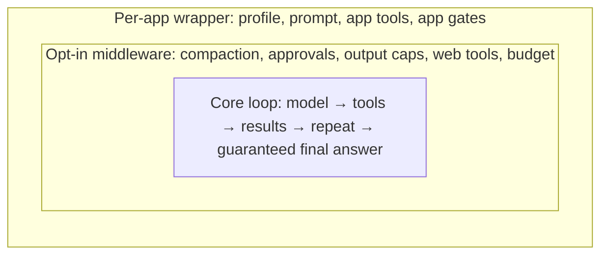

# 40 — Core-loop "onion" refactor plan for LAS and its scraper-service use (2026-10-17)

Status: PLAN (not started). Verification standard: `.agents/plan-verification-standard.md`.
Labels: **VF** verified fact (source/measurement, dated 2026-10-17), **TC** testable claim (check named), **A-n** assumption (risk + validation path).

## 1. Goal and non-goals

Goal: every LAS client (LLMSortObsidian, html-notes, trading-client) runs on one small core loop:

Non-goals: editing Rod's repos (prism-service, tools-service, …); changing trading control endpoints; replacing scraper-service; new models.

## 2. Evidence base (what was measured today)

| ID | Claim | Label | Evidence |
|---|---|---|---|
| E1 | LAS was forked from prism at bbe0c914 (2026-06-28); prism has since ~doubled its harness and added ~25 lifecycle modules LAS lacks | VF | LAS commit e272628, 318 identical blobs; LOC diff (PrismHarnessStudy) |
| E2 | LAS has 6 tool-call loops (ReAct, PromptedToolCalling, VisionLanguage, ToT, GoT, ChatRoutes FC) + 1 in the Obsidian plugin | VF | LasHarnessInventory, file:line in §4 |
| E3 | `/v1/runs` tool failures throw and kill the run (`messages: []`); `read_page` 15 s timeout or failed `global.web.search` ends the run | VF | LasHarnessInventory |
| E4 | `CanonicalProviderBudget` counts JSON bytes as tokens and re-counts full context per call; trading run died `TOKEN_BUDGET_EXHAUSTED` | VF | `CanonicalProviderBudget.ts:33`; trading-client trace |
| E5 | `POST /execute/global.web.search` returns 200 "Tool not found" while `/v1/contracts/capabilities` lists it | VF | GlmLasToolProbe; `LocalToolRouter.ts:289-554` has no `global.*` branch |
| E6 | `read_page` returns `success: true` with "Failed to fetch page content: HTTP …" text | VF | `GlobalCapabilityExecutor.ts:383` |
| E7 | LAS ToolExecutor has no per-tool timeout/abort signal; prism has both | VF | `lifecycle/ToolExecutor.ts:120` vs prism `constants.ts:722` |
| E8 | LAS tool list changes every pass (`ReActHarness:354`), breaking prompt cache | VF | PrismHarnessStudy |
| E9 | `RuntimeExtensions.register` is never called outside tests → profiles naming a plugin fail `PROFILE_NOT_READY` | VF | grep (PrismHarnessStudy) |
| E10 | A deadline abort mid-stream crashed the whole LAS process (3× on 2026-10-17) | VF, **fixed** | commit 3f3b45e, regression test `CutStream.test.ts` red/green |
| E11 | Obsidian vault chat dropped streamed `tool_calls` | VF, **fixed** | commit 6a034d8 |
| E12 | scraper-service `/scrape` is honest except crawl4ai FALSE_FAIL (nodejs.org: `success False`, real content missing); only bing returns search results (google/brave/ddg/startpage = 0) | VF | GlmScraperProbe + manual re-check |
| E13 | Same GLM model: omp headless 8/8 PASS; prism `/agent` 4/8 PASS (4 infra 500/timeouts); nemotron35 in omp FAILed q4 claiming no web | VF | GlmOmpProbe, GlmPrismAgentProbe |
| E14 | `x-deadline-ms` capped by profile (180 s trading, 120 s html-notes); GLM news answers take 85–225 s in omp/prism | VF | `INVALID_RUN_REQUEST` text; probe wall times |
| E15 | html-notes news bypasses agents: one-shot nemotron35, 1–2-sentence prompt, 220-char clip | LIKELY (reported, not re-verified) | `routes/message.py:924-953`, `config_builders.py:856`, `canvas_manager.py:698` |

## 3. Cross-harness similarity matrix

| Trait | pi upstream | omp | Hermes | dsh | prism `/agent` | LAS today |
|---|---|---|---|---|---|---|
| One loop, stop when no tool calls | ✔ | ✔ | ✔ | ✔ | ✔ (+strategies) | ✘ 6 loops |
| Tool error → tool result, not throw | ✔ | ✔ | ✔ (2048-char cap) | ✔ | ✔ `{error}` | ✘ `/v1/runs` throws |
| Unknown tool → not-found result | ✔ | ✔ (+suggestion) | ✔ | ✔ | ✔ dropped-call recovery | ✘ / route mismatch (E5) |
| Every call gets a paired result | ✔ | ✔ | ✔ | ✔ | ✔ | partial |
| No tools run from `length`-truncated msg | ✔ | ✔ | ✔ | ✔ | ✔ truncation ladder | UNKNOWN (check in 1.1 spike) |
| Parallel tools, per-tool timeout + abort | ✔ | ✔ | ✔ | ✔ | ✔ 600 s + signal | ✘ no timeout (E7) |
| before/after tool hooks | ✔ | ✔ | ✔ | ✔ | ✔ | ✔ (3 hook systems) |
| Context hook before model call | ✔ | ✔ | ✔ | ✔ | ✔ 8-step pipeline | ✔ (fork version) |
| Typed event stream | ✔ | ✔ | ✔ | ✔ | ✔ zod v1 | ~ flat union, unvalidated |
| Tool output cap + retrievable overflow | coding-agent | ✔ 50 KB | ✔ 15 k chars | ✔ | ✔ | ~ 120-char compaction only |
| Web: search metadata + fetch→markdown, no summarizer | ext | ✔ | ✔ | ✔ | tools-service | ~ two read paths, false success (E6) |
| Guaranteed final answer | hook | `yield` tool | ✔ built in | ✘ | ✔ `tool_choice:none` pass | ✔ ported, but budget/throws pre-empt it |
| Stable tool list per turn | ✔ | ✔ | ✔ | ✔ | ✔ | ✘ (E8) |
| Hard token budget | ✘ | ✘ | ✘ | ✘ | cost cap | ✔ but miscounts (E4) |
| Client-side (remote) tools | via async tool | via async tool | ✘ | ✘ | ✘ | ✔ signed `LocalToolContinuation` |

Shared core (all five reference harnesses agree): rows 1–8. LAS fails 5 of those 8.

## 4. Decision: core-loop base

| Option | Embeds in Node LAS | Verdict |
|---|---|---|
| `@earendil-works/pi-agent-core` + `pi-ai` (MIT, ~675-line loop) | yes (node ≥22.19; LAS node 26) | **Chosen, behind a LAS adapter, exact pin** |
| omp `@oh-my-pi/*` | no (Bun, ships `.ts`) | reference only (dialect parsers) |
| Hermes, dsh, Claude SDK | no (Python / launcher-only / proprietary) | design references |
| Vercel AI SDK `ToolLoopAgent` | yes | runner-up |
| Keep ReActHarness, trim it | yes | rejected: 1032+1741 LOC, 25 layers, 5 of 8 core traits failing |

A-1: pi-ai's `openai-completions` handles GLM `reasoning_content` round-trip and vLLM tool deltas. Risk: thinking blocks dropped → 400s or degraded answers. Validation: Phase 1 spike runs the 8-question probe through the adapter against `http://10.0.0.141:8000/v1`; PASS ≥ omp's 8/8 minus infra failures.
A-2: pi 1.x API churn is tolerable behind an adapter. Risk: hook renames. Validation: adapter is the only importer (lint rule / grep in CI).

## 5. Checklist

### Phase 0 — stop the bleeding (small, independent, ship first)
- [ ] 0.1 `read_page` and scraper read path return `success:false` with an error string on HTTP ≥400, empty body, or timeout (E6). TC: unit test feeding a 404 → `success:false`.
- [ ] 0.2 `/v1/runs` tool failures become tool results with `isError`, not throws (E3). TC: run with a stubbed failing `global.web.search` finishes with a final assistant message, not `messages: []`.
- [ ] 0.3 Per-tool timeout + abort signal in `lifecycle/ToolExecutor.ts` (E7). TC: a never-resolving tool ends with a timeout tool result and the run still answers.
- [ ] 0.4 `/execute/global.*` routes to `GlobalCapabilityExecutor`, or the capability list stops advertising it (E5). TC: `POST /execute/global.web.search` returns results.
- [ ] 0.5 `CanonicalProviderBudget` uses provider-reported `usage` (fallback: chars/4 estimate) and counts only the delta per call (E4). TC: search → read → answer run under 65 536 completes; replay of the trading-client failing request succeeds.
- [ ] 0.6 On budget/deadline exhaustion, run the existing `tool_choice:"none"` final pass before failing, reserving its budget up front. TC: deadline-forced run returns partial answer + `DEADLINE_EXCEEDED` flag, container uptime unchanged.
- [ ] 0.7 Audit remaining `await reader.cancel()` sites (`decision-fabric/SemIfProvider.ts:69`, `TinyModelsProvider.ts:33`) for the E10 pattern.

### Phase 1 — core loop behind an adapter
- [ ] 1.1 Spike: `src/core/loop/` adapter over pi-agent-core; hand-declared vLLM `Model` objects for GLM and nemotron35 with compat flags (A-1).
- [ ] 1.2 Core policy (every client): step budget with forced toolless final turn (Hermes pattern), empty/reasoning-only nudge once, error → terminal SSE with partial text.
- [ ] 1.3 Map pi `AgentEvent` → existing `RunEventType` SSE so clients do not change. TC: existing route contract tests pass unchanged.
- [ ] 1.4 Remote tools: `LocalToolContinuation` becomes a `RemoteTool.execute` awaiting the signed result; keep the signature check.
- [ ] 1.5 Gate: 8-question probe via `/v1/runs` with GLM ≥ omp baseline (excluding infra failures), plus bakeoff arm parity (§6).

### Phase 2 — middleware (opt-in per profile)
- [ ] 2.1 Tool output cap (head+tail, ~15 k chars) with overflow stored and pageable.
- [ ] 2.2 Compaction as `transformContext` (port fork `ContextPressureManager`, keep tool pairs together).
- [ ] 2.3 Approvals as `beforeToolCall` (existing `ApprovalGate`).
- [ ] 2.4 Stable tool list per turn; `describe_tools` becomes append-only activation (E8).
- [ ] 2.5 Web tools: search returns `[n] title (date) url snippet`; fetch returns markdown via scraper-service `/scrape engine:auto`, one read path (delete `safeFetch` text-strip path).
- [ ] 2.6 Register or delete `RuntimeExtensions` (E9).

### Phase 3 — wrappers and client cutover
- [ ] 3.1 LLMSortObsidian: plugin `run_agent` loop → shared `/v1/runs` with vault tools as remote tools (`useSharedRuntime:true`); delete plugin loop.
- [ ] 3.2 html-notes: route news through `/v1/runs` with a news profile; remove 1–2-sentence prompt and 220-char clip (verify E15 first).
- [ ] 3.3 trading-client: profile limits re-sized from measured p95 wall time (E14); no trading control tools added.
- [ ] 3.4 Delete superseded loops: ReActHarness, PromptedToolCalling (move dialect parsing to an opt-in `streamFn` wrapper if nemotron needs it), ChatRoutes FC loop, ToT/GoT (move to a wrapper or delete if unused — check callers).

### Phase 4 — scraper-service (separate repo, LazyCat420-owned)
- [ ] 4.1 Fix search backends: google/brave/duckduckgo/startpage return 0 (E12). TC: `/health/search-engines` shows ≥2 engines with results.
- [ ] 4.2 crawl4ai FALSE_FAIL: return content it extracted or fall through to playwright in `engine:auto`.
- [ ] 4.3 Return dates in search results where engines provide them (LAS "news today" query had none).

### Wrap-up
- [ ] Final gates (tsc, vitest, probe rerun), deploy LAS + scraper-service, live check each client, report.

## 6. Bakeoff: minimal loop vs `/v1/runs` (VF, 2026-10-17, same GLM, same LAS search backend)

| Arm | Setup | PASS / 8 |
|---|---|---|
| A | ~60-line loop, GLM, `search_web` + `read_url` | **8** |
| B | `/v1/runs` trading-strategy-chat-v1 | 3 |
| C | `/v1/runs` html-notes-canvas-v1 (no local tools) | 4 |
| D | ~60-line loop, nemotron35 | 5 (+3 WEAK: no current date) |

Every B/C failure is a layer above the core loop:

| Failure | Hits | Source | Checklist |
|---|---|---|---|
| `TOKEN_BUDGET_EXHAUSTED` with evidence in hand | B q1,q2,q8 | `CanonicalProviderBudget.ts:34-36` bytes-as-tokens, cumulative | 0.5, 0.6 |
| `DEADLINE_EXCEEDED`, no synthesis | B q4,q6; C q2,q6,q8 | `RunExecutionEngine.ts:267-269, 777-791` | 0.6, 3.3 |
| Local tool advertised but no client executes it → hang to deadline | B q4 (`trading.research.web_search`), q6 (`scrape_url`) | `RunExecutionEngine.ts:520-536` catalog fallback; `LocalToolContinuation.ts:9-30` | 0.8 |
| `INCOMPLETE_RUN`: 43-token turn, no text, tool call lost | C q3 (2/2) | thrown `RunExecutionEngine.ts:699-700`; direct vLLM same prompt → tool call 6/6 | 0.9 |
| Process crash on abort | pre-fix B q2 | **fixed 3f3b45e**; 5 post-fix deadline runs, RestartCount 0 | done |
| Prior-session memory in fresh session ("workflow from yesterday") | B partials | not traced (LIKELY) | 0.10 |

Additional Phase 0 items from the bakeoff:
- [ ] 0.8 Do not advertise local tools to the model unless the request declares a client executor (`local_tool_schemas` present / client capability flag). TC: rerun B q4 → global search used, PASS.
- [ ] 0.9 Find where the C q3 tool call is dropped (enable untruncated logging around `ReActHarness`/`VllmShim` stream parse); add a one-shot re-prompt for turns with neither text nor tool calls. TC: C q3 PASS 3/3.
- [ ] 0.10 Trace memory injection for `strategy-chat`; make cross-session memory opt-in per profile. TC: fresh session prompt has no prior-session notes.
- [ ] 0.11 Inject current date into the system context (core policy, cheap). TC: arm D rerun has 0 stale-year answers.

Gate for Phase 1 (TC-1.5): `/v1/runs` B and C each ≥ 7/8 on the probe, matching arm A.
